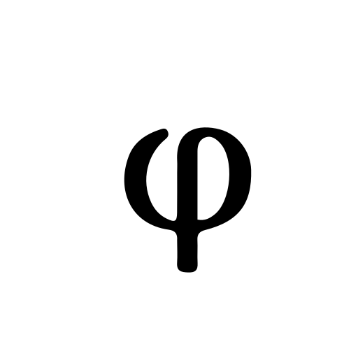

<p align="center">
  <picture>
    <source media="(prefers-color-scheme: dark)" srcset="assets/phi-mono-white.svg">
    
  </picture>
</p>

<p align="center"><em>Community color themes for φ Poiesis.</em></p>

<p align="center">
  A calm, local-first desktop writing app for books, poetry, and essays.<br>
  These are color themes you can install into it — one JSON file each.
</p>

<p align="center">
  <a href="https://getpoiesis.com">Website</a> ·
  <a href="#the-themes">Themes</a> ·
  <a href="#install-a-theme">Install</a> ·
  <a href="#write-your-own">Write your own</a> ·
  <a href="./CONTRIBUTING.md">Contribute</a>
</p>

---

## What these are

φ Poiesis ships with one built-in theme, **Phi** (the official look — neutral
grays, a pure white page in light mode and a pure black page in dark).

Every theme in this repo is an **official theme** you download: Catppuccin,
Dracula, Gruvbox, High contrast, Night, Night Owl, Nord, Paper, Primer, Sepia,
Solarized, Tokyo Night and Warm. φ Poiesis lists them under **Browse official
themes…**, or you can install a file yourself. Themes are *not* part of the
app — they live in your own themes folder and load at runtime.

Each file re-tints the editor's `--ps-*` color tokens. **Any token a theme omits
falls back to the built-in Phi value**, so a theme can re-color everything or
just a few things.

## The themes

Browse [`themes/`](./themes) — every file there is a complete, ready-to-install
theme. The collection grows over time: classic developer palettes alongside
themes made for long-form writing, most shipping both a `light` and a `dark`
variant. Each file's `label` and `description` (the first few lines of the JSON)
tell you what it is and where its palette comes from, and the same description
shows up in φ Poiesis's theme picker once installed.

## Install a theme

1. Download the `.json` you want from [`themes/`](./themes).
2. In φ Poiesis: **Settings → Appearance → Color theme → Install theme…**, then pick the
   file. It's validated and copied into your themes folder, and the theme
   activates. The active **Appearance** (System / Light / Dark) decides whether
   the theme's `light` or `dark` map applies.
3. To tweak one, hit **Open themes folder**, edit the JSON, then re-open Settings
   (themes reload) — or remove and re-install.

## Write your own

A theme is one JSON file:

```jsonc
{
  "id": "my-theme",        // lowercase slug, also the file name; must be unique
  "label": "My Theme",     // shown in the picker
  "description": "…",      // one line in the picker (optional)
  "light": { /* token → color */ },
  "dark":  { /* token → color */ }
}
```

- The `id` must be unique: not `phi`, and not the id of any of the 13 official
  themes in [`themes/`](./themes): `catppuccin`, `dracula`, `gruvbox`,
  `high-contrast`, `night`, `night-owl`, `nord`, `paper`, `primer`, `sepia`,
  `solarized`, `tokyo-night` or `warm`. φ Poiesis keeps only the first theme it
  finds with a given id, so a duplicate would never show up.
- A theme may define `light`, `dark`, or both.
- **Any token you omit falls back to the built-in Phi value**, so you can ship a
  partial theme that only re-tints a few things.
- Every value must be a plain CSS color — hex (`#18181b`), `rgb()/rgba()`,
  `hsl()/hsla()`, or a CSS color name. Anything else is dropped on install, so a
  theme file can never inject anything but a color.

### Themeable tokens

Surfaces & text:
`--ps-bg` (the writing page), `--ps-bg-elev`, `--ps-bg-sidebar`, `--ps-bg-rail`,
`--ps-bg-hover`, `--ps-bg-active`, `--ps-text`, `--ps-text-muted`,
`--ps-text-faint`, `--ps-border`, `--ps-border-strong`.

Accent & semantics:
`--ps-accent`, `--ps-accent-text`, `--ps-wikilink`, `--ps-danger`, `--ps-gold`,
`--ps-flame`, `--ps-success`, `--ps-diff-add`, `--ps-diff-del`,
`--ps-diff-add-bg`, `--ps-diff-del-bg`.

Code syntax:
`--ps-syn-comment`, `--ps-syn-keyword`, `--ps-syn-string`, `--ps-syn-number`,
`--ps-syn-title`, `--ps-syn-attr`, `--ps-syn-tag`.

> Tip: `--ps-bg` is the writing surface itself — set it to `#ffffff` / `#000000`
> for an edge-to-edge white/black page like Phi, or a soft tint for something
> warmer. Structural tokens (fonts, spacing, radius, shadows) aren't themeable.

The quickest way to start is to copy [`themes/nord.theme.json`](./themes/nord.theme.json),
change the `id`, `label`, and colors, and install it.

## Contributing

Got a theme to share? See [`CONTRIBUTING.md`](./CONTRIBUTING.md).

## Credits

Many themes here adapt palettes from existing open-source projects for φ Poiesis's token
system. Those projects keep their own licenses and copyrights; the full upstream
notices — one per adapted theme — are reproduced in
[`THIRD-PARTY-LICENSES.md`](./THIRD-PARTY-LICENSES.md). The φ Poiesis adaptations in this
repo are MIT-licensed (see [`LICENSE`](./LICENSE)).

Such adaptations are unofficial and are **not affiliated with, sponsored by, or
endorsed by** the upstream projects or their authors. A theme's name belongs to
its respective project and is used only to identify the palette it adapts, and no
third-party logos or trademarks are included.

---

<p align="center"><sub>φ Poiesis · <a href="https://getpoiesis.com">getpoiesis.com</a></sub></p>
